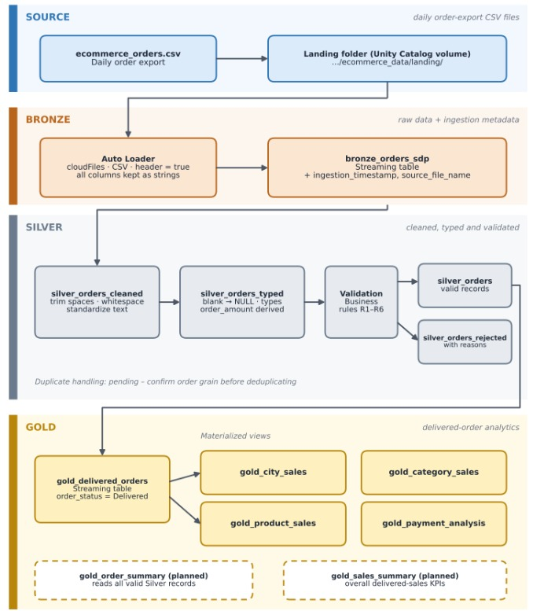
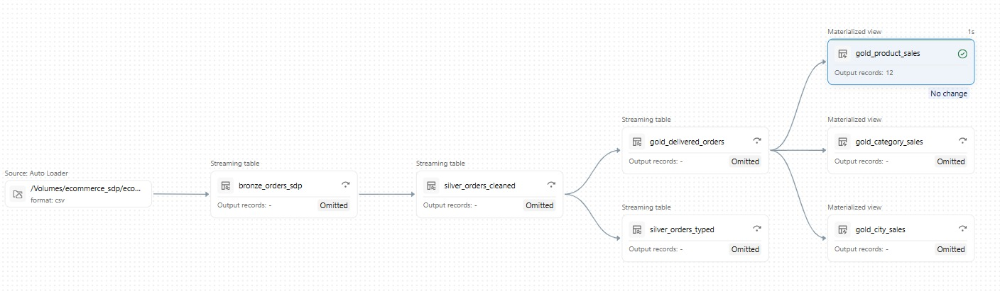

# 🛒 E-Commerce Sales Data Engineering Pipeline

## 📌 Project Overview

This project demonstrates the implementation of an end-to-end **Data Engineering Pipeline** for E-Commerce Sales Data using **Databricks Lakeflow Spark Declarative Pipelines (SDP)** and the **Medallion Architecture (Bronze → Silver → Gold)**.

The pipeline ingests raw CSV data, performs data cleaning and validation, applies business rules, and generates analytics-ready datasets for reporting and decision-making.

---

## 🚀 Objective

The primary objective of this project is to build a scalable and maintainable Data Engineering solution that:

- Ingests raw e-commerce sales data automatically
- Cleans and validates data
- Handles missing and invalid records
- Creates business-ready datasets
- Generates analytical insights for stakeholders
- Follows modern Data Engineering best practices

---

## 🏗️ Architecture

### Medallion Architecture

```text
Raw CSV Files
      │
      ▼
┌─────────────┐
│   Bronze    │
│ Raw Data    │
└─────────────┘
      │
      ▼
┌─────────────┐
│   Silver    │
│ Cleaned &   │
│ Validated   │
└─────────────┘
      │
      ▼
┌─────────────┐
│    Gold     │
│ Analytics & │
│ Aggregates  │
└─────────────┘

```


---

## Pipeline Lineage


---
## 🛠️ Technology Stack

| Technology | Purpose |
|------------|---------|
| Databricks Free Edition | Development Platform |
| Lakeflow SDP | Pipeline Implementation |
| PySpark | Data Transformations |
| Auto Loader (cloudFiles) | Incremental Data Ingestion |
| Delta Tables | Data Storage |
| Unity Catalog | Data Governance |
| Medallion Architecture | Data Organization |

---


---

# 🥉 Bronze Layer

## Purpose

The Bronze layer stores raw source data exactly as received from the landing zone.

### Features

- Auto Loader ingestion
- Schema preservation
- Incremental file processing
- Ingestion tracking
- Source file tracking

### Output Table

```text
bronze_orders_sdp
```

### Metadata Columns

| Column | Description |
|----------|------------|
| ingestion_timestamp | When record was loaded |
| source_file_name | Source file path |

---

# 🥈 Silver Layer

## Purpose

Transforms raw data into clean, standardized, and validated datasets.

### Data Cleaning

- Trim leading and trailing spaces
- Remove extra whitespace
- Standardize text formatting
- Normalize missing values

### Data Type Conversions

| Column | Conversion |
|----------|-----------|
| order_date | String → Date |
| quantity | String → Integer |
| unit_price | String → Decimal |
| order_amount | Derived Column |

### Business Validations

✅ Order ID should not be null

✅ Order Date should be valid

✅ Quantity must be greater than zero

✅ Unit Price must be greater than zero

✅ Required fields should not be null

✅ Order Status should contain valid values

### Output Tables

```text
silver_orders
silver_orders_rejected
```

---

# 🥇 Gold Layer

## Purpose

Provides business-ready analytics and reporting datasets.

Only **Delivered Orders** are considered for revenue analytics.

### Gold Tables

| Table | Description |
|---------|-------------|
| gold_delivered_orders | Delivered orders only |
| gold_city_sales | City-wise sales analysis |
| gold_category_sales | Category-wise sales analysis |
| gold_product_sales | Product-wise sales analysis |
| gold_payment_analysis | Payment-wise revenue analysis |
| gold_order_summary | Order lifecycle summary |
| gold_sales_summary | Overall KPI summary |

---

## Key Business Metrics

### City Sales Analysis

- Total Delivered Orders
- Total Revenue
- Average Order Value
- Revenue Ranking

### Category Sales Analysis

- Units Sold
- Revenue Contribution
- Category Ranking

### Product Sales Analysis

- Product Revenue
- Units Sold
- Average Selling Price

### Payment Analysis

- Payment Mode Performance
- Revenue by Payment Type
- Average Transaction Value

---

## 🔍 Data Quality Measures

The pipeline performs:

- Missing Value Handling
- Type Validation
- Business Rule Validation
- Data Standardization
- Rejected Record Segregation
- Revenue Reconciliation Checks

---

## 📊 Expected Business Outcomes

The Gold layer enables:

- Sales Performance Reporting
- Product Performance Analysis
- City-wise Business Analysis
- Payment Method Insights
- Revenue Monitoring
- KPI Dashboard Development

---

## 🎯 Key Learnings

Through this project, I gained hands-on experience in:

- Data Engineering Fundamentals
- Medallion Architecture
- Databricks Lakeflow SDP
- Auto Loader Implementation
- Data Quality Management
- Delta Tables
- PySpark Transformations
- Business Data Validation
- Analytics Data Modeling

---

## 📈 Future Enhancements

- Real-time streaming ingestion
- Automated data quality monitoring
- Workflow scheduling
- Dashboard integration with Power BI
- Advanced KPI reporting
- Alerting and monitoring framework

---

